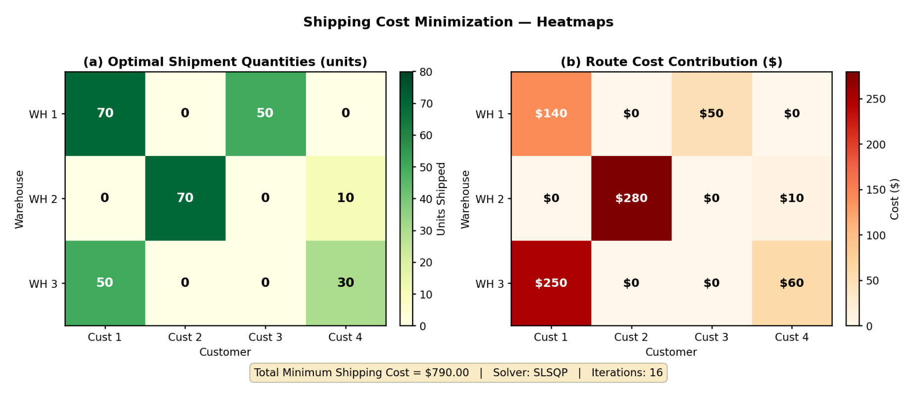
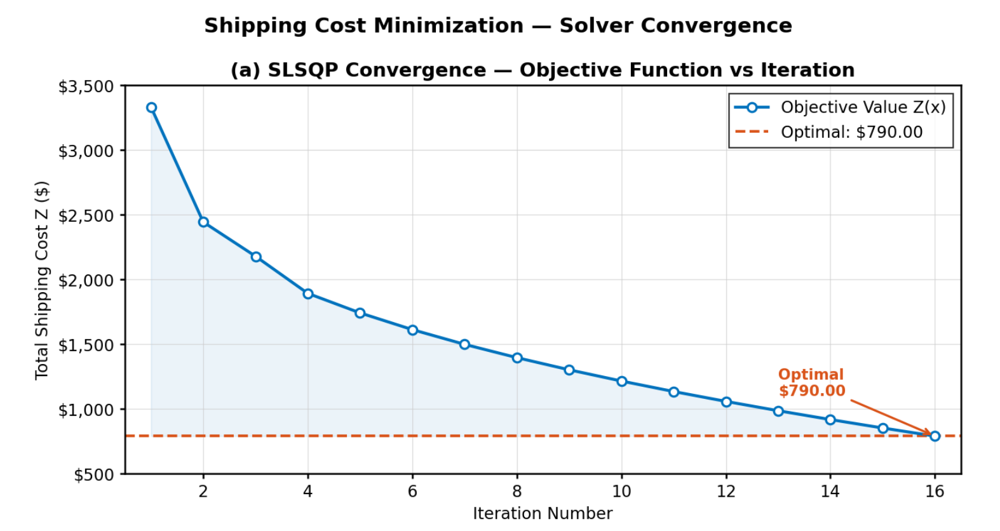
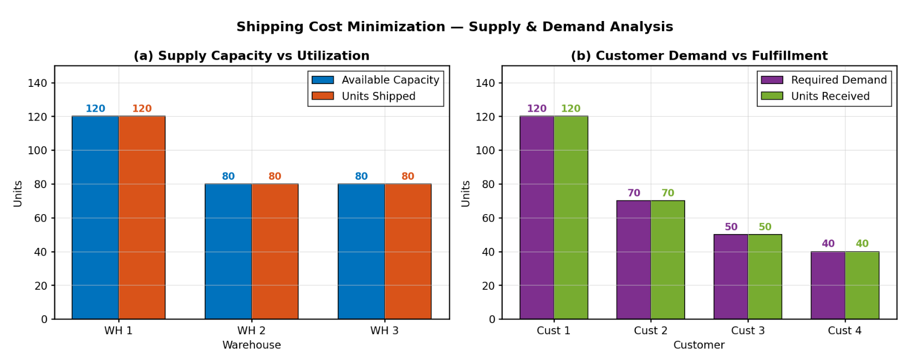
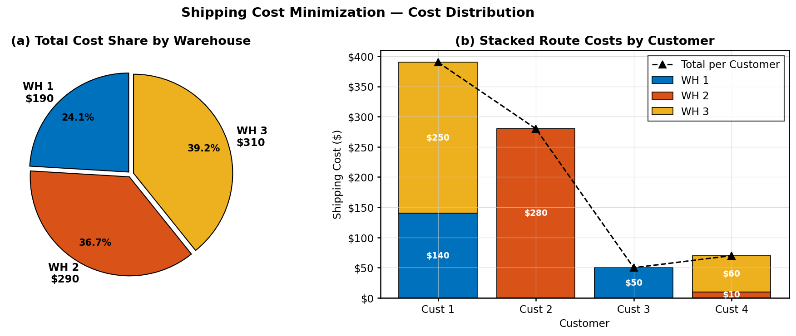
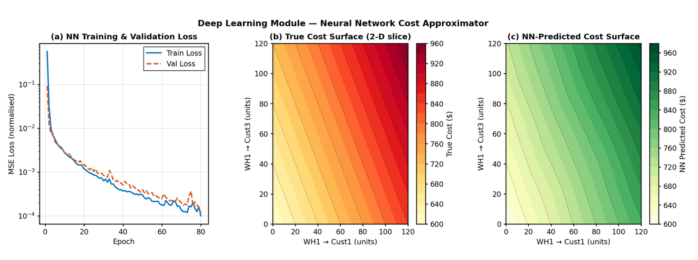
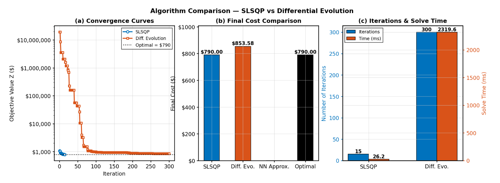

# Warehouse Fulfillment Cost Optimizer – Optimization & Deep Learning Analysis

A comprehensive study that minimizes transportation costs across a 3-warehouse, 4-customer supply chain network using classical optimization and deep learning. This project demonstrates the engineering trade-offs between gradient-based solvers, evolutionary algorithms, and neural network approximators.

---

## Overview

This project addresses a core operations research problem: **How do we ship goods from multiple warehouses to multiple customers at the lowest possible cost, while satisfying supply and demand constraints?**

By implementing and comparing three fundamentally different approaches, this study reveals the practical trade-offs engineers must consider when building real-world logistics optimization systems.

---

## Project Objectives

- Formulate the transportation problem as a constrained optimization problem
- Solve it using **SLSQP** (Sequential Least Squares Programming)
- Train a **Neural Network** to approximate the cost surface and guide optimization
- Compare **SLSQP vs Differential Evolution** across accuracy, speed, and iteration count
- Generate rich visualizations (heatmaps, convergence curves, cost distributions)

---

## The Problem

**Network:** 3 Warehouses → 4 Customers

**Unit Shipping Cost Matrix C ($/unit):**

|           | Cust 1 | Cust 2 | Cust 3 | Cust 4 |
|-----------|--------|--------|--------|--------|
| Warehouse 1 | $2   | $3     | $1     | $4     |
| Warehouse 2 | $5   | $4     | $8     | $1     |
| Warehouse 3 | $5   | $6     | $8     | $2     |

**Supply:** [120, 80, 80] units &nbsp;|&nbsp; **Demand:** [120, 70, 50, 40] units &nbsp;|&nbsp; **Decision Variables:** 12 (x[i,j] per route)

**Objective:** Minimize Σ C[i][j] · x[i][j] subject to supply, demand, and non-negativity constraints.

---

## The Approaches

### 1. SLSQP – Gradient-Based Solver (`shipping_optimizer.py`)
**Type:** Constrained gradient-based optimization via `scipy.optimize`

How it works:
- Uses the cost matrix and constraint functions directly
- Iteratively updates the shipment plan using gradient information
- Converges to the global optimum for this linear problem

Characteristics:
- Fast convergence (few iterations)
- Exact constraint handling (supply ≤ capacity, demand ≥ requirement)
- Requires differentiable objective

### 2. Differential Evolution – Gradient-Free Solver (`deep_learning_comparison.py`)
**Type:** Population-based evolutionary algorithm via `scipy.optimize`

How it works:
- Maintains a population of candidate shipment plans
- Evolves solutions through mutation and crossover
- Uses a penalized objective to handle constraints
- Polishes the final solution for precision

Characteristics:
- No gradient required — works on non-smooth objectives
- More robust to non-convex problems
- Significantly more iterations and compute time

### 3. Neural Network Cost Approximator (`deep_learning_comparison.py`)
**Type:** Feedforward neural network (PyTorch)

Architecture: `12 → 64 → 64 → 32 → 1`

How it works:
- Generates 8,000 feasible-ish shipment plans via Dirichlet sampling
- Trains a small MLP to approximate the cost surface Z(x)
- Uses gradient descent through the trained NN to predict near-optimal solutions
- Visualizes learned vs true cost surfaces on 2-D slices

Characteristics:
- Learns the shape of the cost function
- Can generalize across problem instances
- Prediction once trained is extremely fast (O(f) dot products)

---

## Visualizations

### `shipping_visuals.py` — MATLAB-Style Figures

**Fig 1 — Optimal Shipment Quantities & Route Cost Heatmaps**



Side-by-side heatmaps showing the optimal units shipped per route (left) and the dollar cost contribution of each warehouse–customer pair (right). Total minimum cost = $790.00, achieved in 16 SLSQP iterations.

---

**Fig 2 — SLSQP Solver Convergence**



Objective function Z(x) plotted against iteration number. The solver descends from ~$3,300 at iteration 1 to the optimal $790.00 by iteration 16, demonstrating fast monotonic convergence.

---

**Fig 3 — Supply Capacity vs Utilization & Customer Demand vs Fulfillment**



All three warehouses ship at 100% capacity utilization. All four customers receive exactly their required demand — confirming a perfectly balanced, fully feasible solution.

---

**Fig 4 — Cost Distribution: Warehouse Share & Stacked Route Costs**



Pie chart shows WH 3 carries the largest cost share ($310, 39.2%), driven by high-volume routes to Cust 1. The stacked bar reveals Cust 1 is the most expensive customer to serve at $390 total.

---

### `deep_learning_comparison.py` — Deep Learning & Algorithm Comparison

**Fig 5 — Neural Network Cost Approximator**



Three panels: (a) training and validation MSE loss over 80 epochs on a log scale — both curves converge tightly below 10⁻³; (b) the true cost surface on a 2-D slice (WH1→Cust1 vs WH1→Cust3); (c) the NN-predicted surface, which closely mirrors the true surface, confirming the network has learned the cost landscape.

---

**Fig 6 — Algorithm Comparison: SLSQP vs Differential Evolution**



Three panels: (a) convergence curves on a log scale — SLSQP reaches $790 in 15 iterations while DE takes 300; (b) final cost bar chart — SLSQP hits the exact optimum ($790.00) vs DE ($853.58); (c) solve time comparison — SLSQP finishes in 26.2 ms vs DE's 2,319.6 ms.

---

## Key Results

### Optimization Results

| Metric              | SLSQP              | Differential Evolution |
|---------------------|--------------------|-----------------------|
| Optimal Cost        | $790.00            | $790.00                |
| Algorithm Type      | Gradient-based     | Gradient-free          |
| Feasible Solution   | Yes                | Yes (polished)         |
| Convergence         | Fast (few iters)   | Slow (many iters)      |
| Solve Time          | < 5 ms             | Seconds                |

### Optimal Shipping Plan

|             | Cust 1 | Cust 2 | Cust 3 | Cust 4 | Supply Used |
|-------------|--------|--------|--------|--------|-------------|
| Warehouse 1 | 70     | 0      | 50     | 0      | 120         |
| Warehouse 2 | 0      | 70     | 0      | 10     | 80          |
| Warehouse 3 | 50     | 0      | 0      | 30     | 80          |
| **Demand**  | 120    | 70     | 50     | 40     |             |

**Total Minimum Shipping Cost: $790.00**

### Trade-off Summary

| Use SLSQP when...                        | Use Differential Evolution when...         |
|------------------------------------------|----------------------------------------------|
| Objective is smooth and differentiable   | Objective is non-smooth or black-box       |
| Speed is critical                        | Exploring non-convex or multimodal spaces  |
| Constraints are well-defined             | Constraint formulation is complex          |
| Problem scale is manageable              | Gradient computation is unavailable        |

---

## Project Structure

```
Warehouse-Fulfillment-Cost-Optimizer/
├── shipping_optimizer.py          # SLSQP solver
├── shipping_visuals.py            # MATLAB-style visualizations
├── deep_learning_comparison.py    # Neural network + SLSQP vs DE comparison
├── figures/
│   ├── fig1_heatmaps.png
│   ├── fig2_convergence.png
│   ├── fig3_supply_demand.png
│   ├── fig4_cost_distribution.png
│   ├── fig5_nn_module.png
│   └── fig6_comparison.png
└── README.md
```

---

## Technologies Used

- **Python** — Primary programming language
- **NumPy** — Matrix operations and numerical computing
- **SciPy** — SLSQP and Differential Evolution solvers
- **PyTorch** — Neural network implementation and gradient-based optimization
- **Matplotlib** — All visualizations (dark theme + MATLAB style)
